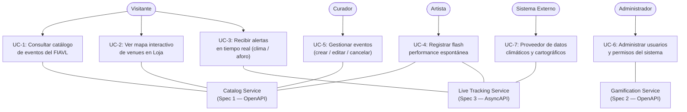
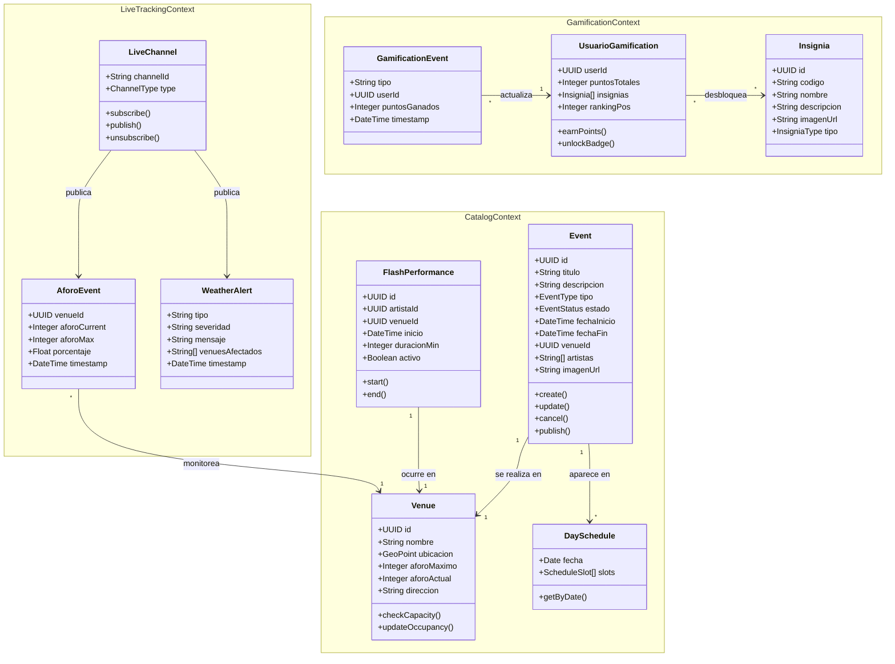
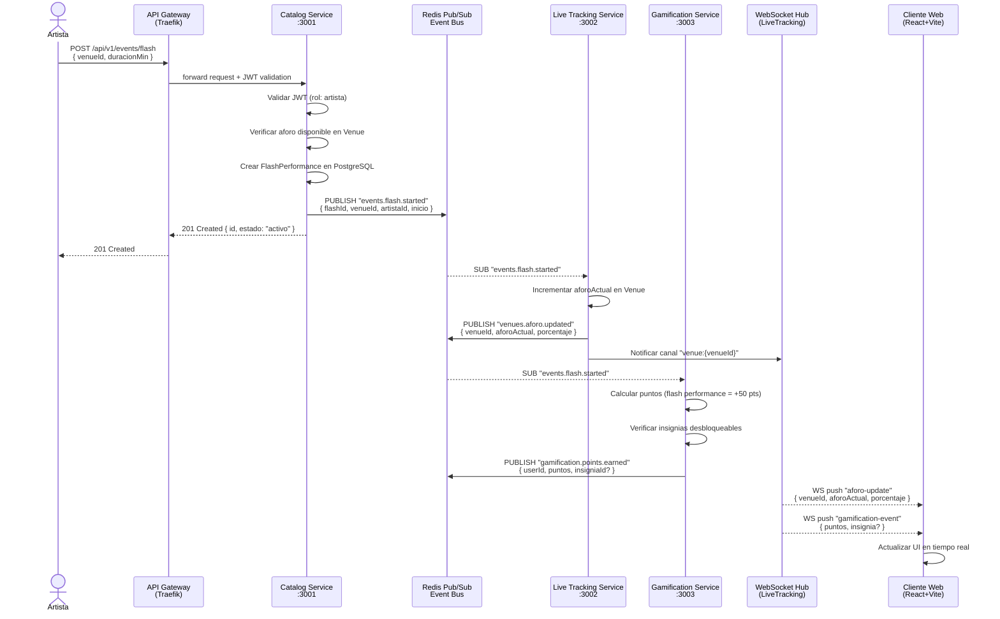
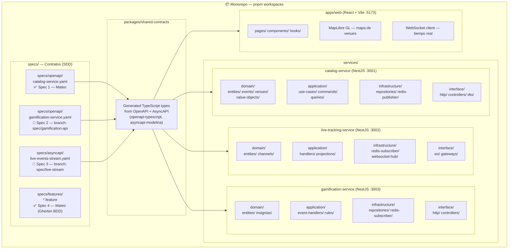
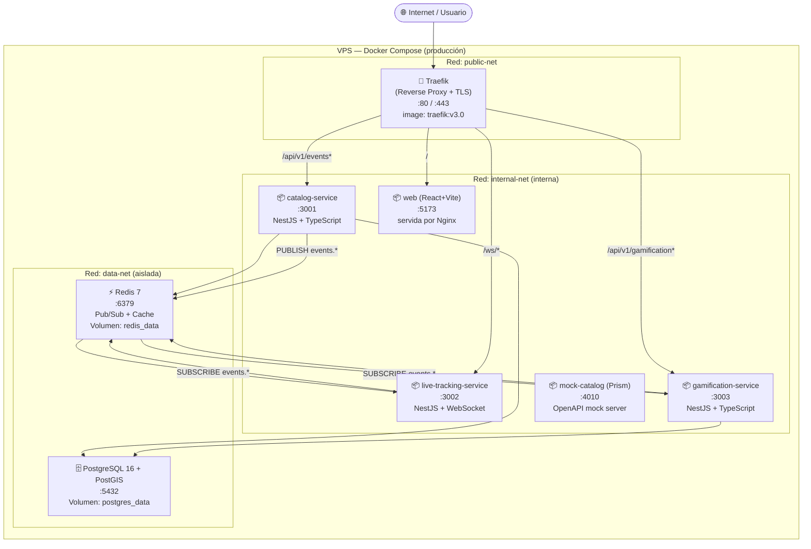

# Arquitectura 4+1 Vistas — Pulso Loja (FIAVL)

> **Metodología:** Modelo de 4+1 Vistas de Philippe Kruchten  
> **Estilo arquitectónico:** Event-Driven Architecture (EDA) + Specification-Driven Development (SDD)  
> **Plataforma:** Festival Internacional de Artes Vivas de Loja — Ecuador

---

## Vista +1 — Escenarios (Casos de Uso)

La vista de escenarios captura los casos de uso más significativos del sistema. Sirve como eje integrador de las demás cuatro vistas.

**Actores:**
- **Visitante** — asistente anónimo al festival
- **Artista** — creador de flash performances espontáneas
- **Curador** — gestor oficial del catálogo de eventos
- **Administrador** — operador técnico con acceso total
- **Sistema Externo** — integraciones (OpenWeather, MapLibre GL)



---

## Vista 1 — Lógica

La vista lógica muestra los principales elementos funcionales del sistema: Bounded Contexts, entidades de dominio y sus relaciones.

**Bounded Contexts:**
- **CatalogContext** — Gestión del catálogo de eventos y venues
- **LiveTrackingContext** — Telemetría en tiempo real, clima y aforo
- **GamificationContext** — Insignias, puntos y ranking de artistas



---

## Vista 2 — Procesos

La vista de procesos muestra cómo los componentes del sistema interactúan en tiempo de ejecución. Se ilustra el flujo más crítico: **registro de una Flash Performance y propagación de eventos**.



---

## Vista 3 — Desarrollo

La vista de desarrollo describe la organización estática del código fuente: estructura del monorepo, capas de Clean Architecture por servicio, y dependencias entre módulos.



> **Convención de capas (Clean Architecture):**  
> `domain` → `application` → `infrastructure` → `interface`  
> Las dependencias apuntan siempre hacia el interior (domain no depende de nada externo).

---

## Vista 4 — Física (Despliegue)

La vista física describe el mapeo de los procesos software a nodos de hardware/infraestructura: contenedores Docker Compose, redes y volúmenes.



**Volúmenes persistentes:**
| Volumen | Contenido | Respaldo |
|---------|-----------|----------|
| `postgres_data` | Eventos, venues, usuarios, insignias | pg_dump diario |
| `redis_data` | Cache y cola de eventos (AOF) | redis-cli SAVE |

**Variables de entorno críticas (`.env.example`):**
```
POSTGRES_DB=artesvivas
POSTGRES_USER=avuser
POSTGRES_PASSWORD=<secret>
REDIS_HOST=redis
JWT_SECRET=<secret>
```

---

## Resumen de Decisiones Arquitectónicas

| ADR | Decisión | Alternativa Descartada | Razón |
|-----|----------|------------------------|-------|
| [ADR-0001](adr/0001-event-driven-architecture.md) | Event-Driven Architecture | Modular Monolith | EDA permite desacoplamiento real entre servicios |
| [ADR-0002](adr/0002-specification-driven-development.md) | Spec-First (SDD) | Code-First | Contrato como única fuente de verdad antes de implementar |
| [ADR-0003](adr/0003-redis-as-event-bus.md) | Redis Pub/Sub como Event Bus | Kafka, RabbitMQ | Menor overhead operativo; suficiente para escala del festival |

---

*Generado como parte del entregable académico — Arquitectura de Software, 2026*
