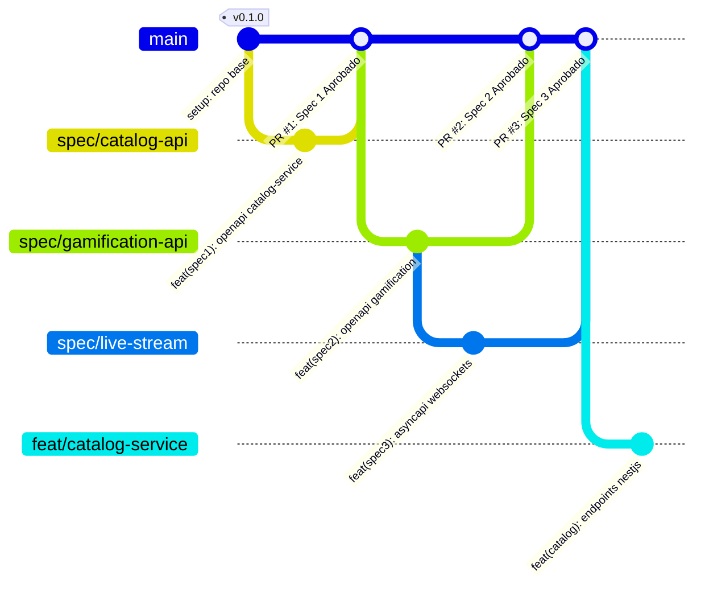

# 🐙 Guía de Trabajo Colaborativo con GitKraken — Pulso Loja (FIAVL)

Esta guía define cómo los **3 integrantes** del equipo colaboran usando **GitKraken** para el flujo de ramas (*Branch-Based Workflow*), garantizando una evidencia visual impecable para el video de sustentación de 5 minutos.

---

## 1. Configuración Inicial en GitKraken

1. Abrir **GitKraken Client**.
2. Ir a **File → Open Repo** y seleccionar la carpeta:  
   `artes-vivas-loja/`
3. En la barra superior, verificar que la rama activa sea `main` (o `master`).
4. Si ya crearon el repositorio en GitHub:
   - Configurar el Remote: **Remotes → (+) Add Remote → GitHub**.
   - Conectar sus cuentas de GitHub para que los avatares de los 3 aparezcan en el grafo.

---

## 2. Mapa Visual de Ramas para el Equipo

En GitKraken, el árbol de commits debe verse claramente dividido por responsabilidades:

---

## 3. Instrucciones Paso a Paso por Integrante

### 👤 Integrante 1: Mateo (Tú)
* **Tus ramas:**
  * `spec/catalog-api` → Creación y ajustes del Spec 1 (OpenAPI del Catálogo). *(Ya listo en `main`)*.
  * `spec/bdd-rules` → Escenarios de negocio Gherkin BDD (Spec 4).
  * `feat/catalog-service` → Implementación del microservicio de catálogo.
* **Acción en GitKraken:**
  1. Click derecho sobre `main` → **Create branch here** → `spec/bdd-rules`.
  2. Commitear los archivos `.feature` de pruebas.
  3. Push y crear Pull Request hacia `main`.

---

### 👤 Integrante 2
* **Su rama:** `spec/gamification-api`
* **Su responsabilidad:** Elaborar el Spec 2 (OpenAPI de gamificación, pasaporte y votos).
* **Acción en GitKraken:**
  1. Click derecho sobre `main` → **Create branch here** → `spec/gamification-api`.
  2. Agregar `specs/openapi/gamification-service.yaml`.
  3. En GitKraken, hacer stage de los cambios en el panel derecho.
  4. Mensaje de commit: `feat(spec2): definir contrato openapi para gamification-service`.
  5. Click en **Push** y abrir Pull Request en GitHub.
  6. Pedir la revisión y aprobación de Mateo y del Integrante 3.

---

### 👤 Integrante 3
* **Su rama:** `spec/live-stream`
* **Su responsabilidad:** Elaborar el Spec 3 (AsyncAPI de WebSockets y telemetría en vivo).
* **Acción en GitKraken:**
  1. Click derecho sobre `main` → **Create branch here** → `spec/live-stream`.
  2. Agregar `specs/asyncapi/live-events-stream.yaml`.
  3. Mensaje de commit: `feat(spec3): definir canales asyncapi para live stream y alertas`.
  4. Push y abrir Pull Request en GitHub.
  5. Pedir revisión y aprobación del equipo.

---

## 4. Convención de Commits (Conventional Commits)

Para que el historial en GitKraken luzca profesional ante el evaluador:

| Prefijo | Cuándo usarlo | Ejemplo |
| :--- | :--- | :--- |
| `feat(spec):` | Nueva especificación o endpoint en spec | `feat(spec1): agregar endpoint DELETE /events/{id}` |
| `fix(spec):` | Corrección de error o validación en contrato | `fix(spec2): ajustar rango de calificacion 1-5` |
| `test(bdd):` | Escenarios Gherkin nuevos o modificados | `test(bdd): agregar regla de aforo maximo al 100%` |
| `feat(svc):` | Código de implementación de un servicio | `feat(catalog): controller y service de eventos` |
| `ci:` | Cambios en workflows de GitHub Actions | `ci: agregar linter spectral para openapi` |
| `docs:` | Documentación y modelos arquitectónicos | `docs: modelo 4+1 vistas en mermaid` |

---

## 5. Qué Mostrar en el Video de Sustentación (Minuto de GitKraken)

Durante la exposición de la dinámica de trabajo (aprox. **minuto 2:30 a 3:30**):
1. **Abrir la pantalla de GitKraken a pantalla completa.**
2. **Señalar el grafo de ramas:**
   * *"Aquí se evidencia nuestra dinámica de trabajo colaborativa basada en ramas."*
   * *"Cada integrante abrió su propia rama para su especificación (`spec/*`), respetando la metodología SDD."*
   * *"Ningún código ni contrato entró a `main` sin pasar por Pull Request y revisión por pares."*
3. Mostrar un commit específico donde se vean los autores y cómo las ramas confluyen limpiamente.
